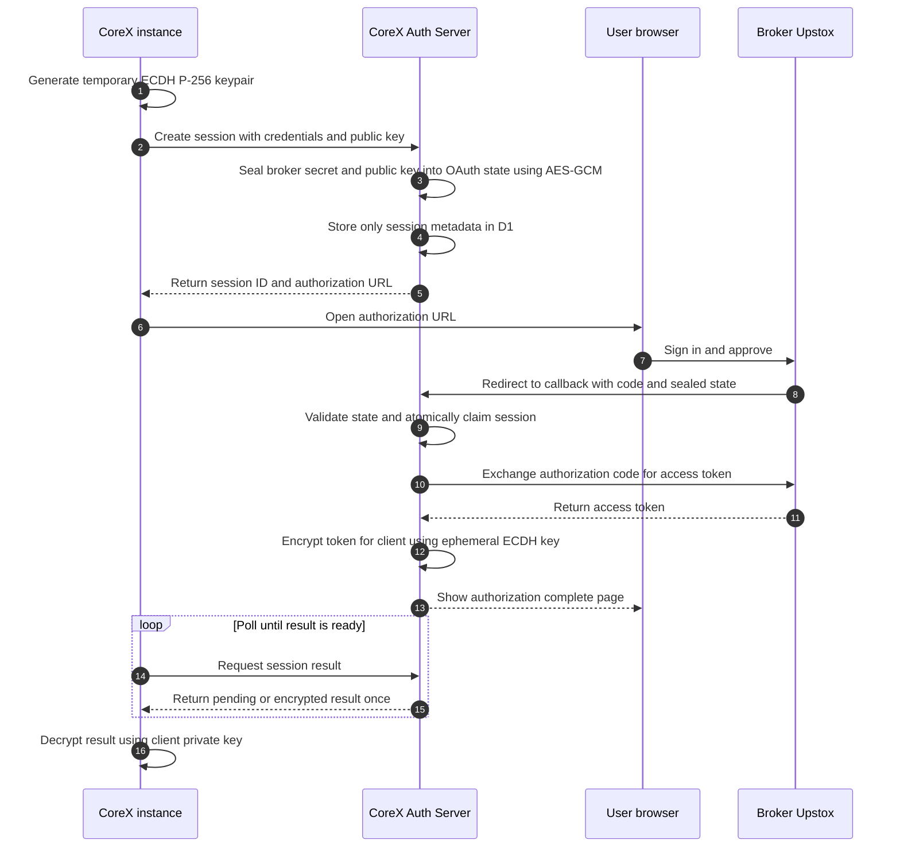

# CoreX Auth Server

A Cloudflare Worker that runs the **entire broker OAuth login on behalf of CoreX instances**:
it hosts the callback, exchanges the authorization code for an access token, and hands the
token back **end-to-end encrypted** to the instance that asked for it. Instances need no local
port, no callback listener and no token-exchange code.

* **Brokers:** Upstox today. Adding another is one provider file ([docs/adding-a-broker.md](docs/adding-a-broker.md)).
* **Stack:** Cloudflare Workers + D1 + Rate Limiting + Cron Trigger.
* **Design rule:** the server never stores a broker secret, an authorization code, or a readable access token.

## Want to use it?

Access is by registration. Registration gives you a **CoreX client API key**; without one, every
API call is rejected. To register, email **ashishsindhav02@outlook.com** with your name/project and
what you intend to use it for. The key is shown once and only its hash is stored, so keep it private.
Then follow [Quick start](#quick-start-for-a-registered-client).

## How it works



## What is public, private, and stored

| Thing | Who can reach / see it |
|---|---|
| `GET /api/health`, `GET /auth/response`, login page | Public (no secrets involved) |
| `GET /auth/:broker/callback` | Public by necessity (the broker's redirect). Useless without a valid sealed `state`; rate-limited by IP |
| `POST/GET /api/v2/auth/...` | Registered clients only (`Authorization: Bearer <CoreX client key>`). A client can only read its own sessions |
| `/api/v1/admin/*` and the dashboard | Operators only (password login + signed cookie, or admin key) |

| Data | Stored on the server? |
|---|---|
| Broker app **secret** | **No.** Exists only inside the sealed `state` (in the login URL, unreadable without the server key) and in memory while the callback runs |
| Authorization **code** | **No.** Used in memory for the exchange |
| **Access token** | Only as ciphertext that **only the requesting client can decrypt**; lives until first fetch (or ~5 min), then wiped (a cron also wipes leftovers) |
| CoreX client API keys | Only their SHA-256 hash |
| Broker app id, session status/timestamps, request metadata | Yes (needed for the dashboard). No bodies, no tokens |
| Client's **private key** | Never leaves the client |

**Honest limits:** the server necessarily sees the broker secret in memory while it performs the
exchange, so whoever can deploy code to the Worker (your Cloudflare account) is trusted. Brokers
decide token lifetime (Upstox tokens expire daily ~03:30 IST and have no refresh token; run the login again).

## Quick start for a registered client

You need: your CoreX client key, your broker app's API key + secret, and the broker app's
redirect URL set to `https://<server>/auth/<broker>/callback`
(Upstox: `https://corex-server.corex-services.workers.dev/auth/upstox/callback`).

1. **Make a keypair** (new one per login) and keep the private half local:
   see `tools/keygen.mjs`, or the Node reference in [docs/client-example.mjs](docs/client-example.mjs).
2. **Create a session**
   ```http
   POST /api/v2/auth/sessions
   Authorization: Bearer <COREX_CLIENT_API_KEY>
   Content-Type: application/json

   { "broker": "upstox", "appId": "<API_KEY>", "appSecret": "<API_SECRET>", "clientPublicKey": "<base64url>" }
   ```
   -> `201 { sessionId, broker, authorizationUrl, expiresInSeconds, expiresAt }`
3. **Open `authorizationUrl`** in the user's browser; they log in and approve (within 5 minutes).
4. **Poll** `GET /api/v2/auth/sessions/:sessionId/result` with the same bearer key.
5. **Decrypt** the `encrypted` object with your private key to get
   `{ accessToken, tokenType, expiresAt, profile }`. Details of the format: [docs/client-integration.md](docs/client-integration.md).

Prefer clicking to coding? [docs/postman-guide.md](docs/postman-guide.md) walks through the whole thing in Postman.

## API reference (v2)

Base URL: `https://corex-server.corex-services.workers.dev`

### `POST /api/v2/auth/sessions`

Body fields (all required strings): `broker`, `appId`, `appSecret`, `clientPublicKey`.

| Status | Body | Meaning / fix |
|---|---|---|
| `201` | `{sessionId, broker, authorizationUrl, expiresInSeconds, expiresAt}` | Open the URL |
| `400` | `{error:"invalid_request", field, message}` | `field` names the bad input (never its value). See [troubleshooting](docs/postman-guide.md#troubleshooting) |
| `400` | `{error:"unsupported_broker", message}` | Message lists supported brokers |
| `401` | `{error:"unauthorized"}` | Missing/invalid/revoked client key |
| `429` | `{error:"rate_limit_exceeded"}` | Max 10 session creations/min per client |
| `500`/`503` | | Server misconfigured or dependency down; contact the operator |

### `GET /api/v2/auth/sessions/:sessionId/result`

| Status | Body | Meaning |
|---|---|---|
| `202` | `{status:"pending"}` | Login not finished yet (or exchange in flight): poll again |
| `200` | `{status:"completed", encrypted:{v,alg,epk,iv,ct}}` | Decrypt it. **Retrievable once** |
| `409` | `{status:"failed", error}` | `authorization_denied`, `exchange_rejected`, `provider_unreachable`, `provider_unavailable`, `provider_bad_response`, `encryption_failed` |
| `410` | `{status:"expired" \| "already_retrieved"}` | Start a new session |
| `404` | `{error:"session_not_found"}` | Unknown session, or not yours |
| `429` | | Max 120 polls/min per client |

Sessions live 5 minutes (plus 60 s to fetch a ready result). Poll about every 2 seconds.

### Other endpoints

`GET /api/health` (public). `GET /auth/:broker/callback` is the broker redirect target; people never call it manually.
The v1 endpoints still exist but are deprecated: [docs/api-v1-deprecated.md](docs/api-v1-deprecated.md).

## Admin Console (operators)

Served by the same Worker; unauthenticated visitors to `/` go to `/login.html`.

* Sessions table shows broker, **API version** (v1/v2), expiry and status: * v2 session statuses: *Awaiting broker*, *Processing token*, *Token ready*, *Encrypted result fetched*, *Failed*, and *Expired*. Legacy v1 sessions retain their original status labels., *Failed · <reason>*, *Expired*. It never shows tokens, secrets or codes.
* Clients (search, inspect, **revoke**: also expires that client's open sessions), request log with CSV export, usage and rate-limit overview.
* Passwords: PBKDF2-HMAC-SHA-256 with per-user salts. Session cookie: signed, 30 min, `HttpOnly`, `SameSite=Strict`, `Secure` on HTTPS. State-changing cookie requests enforce same-origin. CSP and `Referrer-Policy: no-referrer` are set.
* An optional `COREX_ADMIN_API_KEY` allows scripted admin API access. Treat it as a high-privilege secret.

### Admin API

All `/api/v1/admin/*` routes require an authenticated admin session cookie or the configured admin bearer key.

| Method and path | Purpose |
|---|---|
| `POST /api/v1/admin/login` | Sign in and establish the dashboard session cookie. |
| `POST /api/v1/admin/logout` | End the browser session. |
| `GET /api/v1/admin/me` | Get the current admin identity. |
| `GET /api/v1/admin/overview?period=24h` | Dashboard metrics; periods are `24h`, `7d`, or `30d`. |
| `GET /api/v1/admin/requests?limit=25&period=24h&cursor=...` | Paginated request logs. Limits are capped at 100. |
| `GET /api/v1/admin/clients?q=...&limit=50` | List or search registered clients. |
| `GET /api/v1/admin/clients/:clientId` | Inspect a client and related sessions. |
| `POST /api/v1/admin/clients/:clientId/revoke` | Revoke a client and expire its open sessions. |
| `GET /api/v1/admin/sessions?limit=50&status=...&broker=...` | List and filter OAuth sessions. |
| `GET /api/v1/admin/sessions/:sessionId` | Inspect a session. |
| `POST /api/v1/admin/sessions/:sessionId/invalidate` | Invalidate an open session. |

There is no public client-registration endpoint in this repository; active client credentials must be provisioned through a trusted operator process.


## Operator guide

### Registering a client

There is deliberately no public registration endpoint. After someone asks for access:

```bash
npm run create-client -- "Display name"            # dry run: prints the key and the SQL, writes nothing
npm run create-client -- "Display name" --remote   # inserts into production D1
```

It prints the **API key once**; send it to the client over a private channel. To cut a client off, use *Revoke* in the dashboard.

### Configuration

| Name | Kind | Purpose |
|---|---|---|
| `COREX_STATE_KEY` | secret | 32 random bytes, base64url. Seals OAuth state. Rotating it only breaks logins in flight |
| `COREX_ADMIN_USERS`, `COREX_ADMIN_SESSION_SECRET` | secrets | Dashboard accounts (generate with `node scripts/setup-admin-users.cjs`) |
| `COREX_ADMIN_API_KEY` | secret (optional) | Bearer access to the admin API |
| `UPSTOX_REDIRECT_URI` | var (`wrangler.jsonc`) | Must equal the redirect URL registered in the Upstox app |
| `DB` | D1 binding | Sessions, clients, request log |
| `AUTH_SESSION_LIMITER` 10/min, `AUTH_POLL_LIMITER` 120/min, `CALLBACK_LIMITER` 120/min, `ADMIN_LOGIN_LIMITER` 5/min | rate limits | See `wrangler.jsonc` |

Generate the state key and store it:

```bash
node -e "console.log(require('crypto').randomBytes(32).toString('base64url'))"
npx wrangler secret put COREX_STATE_KEY
```

### Local development

```bash
npm install
node scripts/setup-admin-users.cjs        # writes .dev.vars incl. COREX_STATE_KEY
npx wrangler d1 migrations apply corex-db --local
npm run dev
npm test                                   # offline end-to-end suite (Node 22.5+)
```

Local runs cannot complete a real broker login (the broker only redirects to your registered HTTPS URL); use the deployed Worker for that.

### Deploy

```bash
npx wrangler d1 time-travel info corex-db          # note the bookmark = restore point
npx wrangler d1 migrations apply corex-db --remote
npm run deploy
curl https://<your-worker>/api/health
```

### Free-tier behaviour

A login costs roughly 10 D1 writes (about 10,000 logins/day on the free plan). `last_seen_at` updates at most every 5 minutes, and `202 pending` polls are not logged. A Cron Trigger (every 10 min) expires stale sessions, wipes leftover ciphertext, and prunes request logs older than 30 days and finished sessions older than 90 days (`server/services/maintenance.service.js`).

### Request logging

D1 `request_logs` stores method, normalized path, status, duration, client id and broker. Never bodies, headers, query strings or tokens.

## Documentation map

| File | Contents |
|---|---|
| [docs/postman-guide.md](docs/postman-guide.md) | Click-by-click end-to-end test + troubleshooting table |
| [docs/client-integration.md](docs/client-integration.md) | Client flow and the exact encryption envelope (any language) |
| [docs/client-example.mjs](docs/client-example.mjs) | Runnable Node reference client |
| [docs/adding-a-broker.md](docs/adding-a-broker.md) | The provider contract |
| [docs/cleanup.md](docs/cleanup.md) | Post-launch cleanup and v1 removal checklist |
| [docs/api-v1-deprecated.md](docs/api-v1-deprecated.md) | Legacy flow |

## Security notes

* Never share client keys, admin credentials, broker secrets, private keys or tokens (screenshots, chats, shared Postman workspaces).
* No formal audit or certification is claimed. Review before relying on it for anything beyond personal/small-team use.
* Decide backup and monitoring practices before running at larger scale (D1 Time Travel gives 30-day point-in-time restore).

## Contact

Registration, access, questions: **ashishsindhav02@outlook.com**
